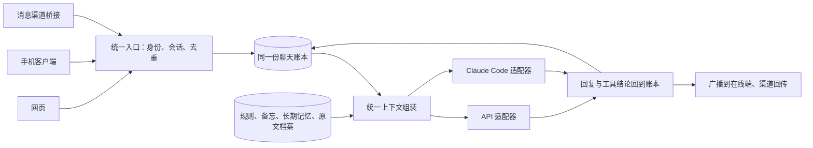

# 让 AI 接得上话

**一个自建 AI 应用的上下文工程手册：API 缓存、聊天压缩、记忆召回、API / Claude Code 切换，以及多端渠道共享上下文。**

你在网页说了一件事，换到手机继续聊，模型还能接上；从普通 API 切到能操作文件的 Claude Code，它也知道前面发生了什么。实现这件事，靠的是应用自己保管记录、组织上下文和交接状态。

这份教程整理自一个持续使用的个人 AI 应用。文中的案例、人物、消息和代码均为重新编写的公开示例；没有附带实际聊天库、记忆库、个人设定、服务地址或登录凭据。

## 先用一句人话理解

每次找模型说话前，应用先准备一个“随身资料包”：

```text
稳定设定 + 必须记住的事 + 旧聊天摘要 + 最近原话
        + 这次相关的记忆 + 当前渠道信息 + 这次的新消息
```

网页、手机、消息桥接都把新消息交给同一个后端。后端保管总记录，准备资料包，再选 API 或 Claude Code 去处理。



这里的 **harness**，可以理解为“让模型能用工具干活的那套程序”。Claude Code 提供工具执行与任务循环；应用仍然可以自己管理长期记录和发给模型的上下文。

## 读之前分清四件事

| 东西 | 负责什么 | 不负责什么 |
|---|---|---|
| Prompt cache | 降低相同前缀的重复处理成本 | 保存长期记忆、扩大上下文窗口 |
| 聊天压缩 | 用摘要与原文窗口控制单轮输入 | 保证所有细节都永远保留在当前请求 |
| 记忆系统 | 保存可追溯的事实，并按当前问题找回来 | 每轮把整个数据库塞给模型 |
| 渠道 / 引擎适配 | 统一消息来源、切换生成方式和工具 | 自动同步彼此独立的聊天库 |

## 从哪里开始

1. [整体架构：谁保管聊天，谁负责回复](docs/01-architecture.md)
2. [API 缓存：让稳定内容真正命中](docs/02-prompt-cache.md)
3. [上下文压缩：旧事整理成摘要，近事保留原话](docs/03-context-compression.md)
4. [记忆写入、分层注入与召回](docs/04-memory.md)
5. [API 与 Claude Code 怎么切换](docs/05-api-and-cc.md)
6. [网页、手机、消息渠道如何互通](docs/06-multi-channel.md)
7. [验证、观测与回退](docs/07-observability.md)

## 五分钟离线体验

需要 Python 3.10+，只用标准库，不需要模型账号，不会发起网络请求：

```bash
python3 examples/demo.py
python3 examples/anthropic_payload.py
python3 examples/cc_command.py
python3 -B -m unittest discover -s tests -v
```

- `demo.py`：模拟网页提到一个约定，手机接着问，再换引擎；展示共享历史、摘要、召回和幂等去重。
- `anthropic_payload.py`：输出一份包含缓存断点的虚构 Messages 请求，观察易变内容摆在哪里。
- `cc_command.py`：展示 `claude -p` 的参数及标准输入，默认不启动 Claude Code。

这些例子演示数据流和边界。里面的“回复器”和“摘要器”是明确标注的教学替身，词命中检索也不冒充向量检索；它们不能验证真实模型记忆效果、缓存命中或网关兼容性。

## 采用前先看这个边界

本仓库给出两部分内容：从实际运行中总结的架构经验，以及方便独立复现的最小示例。示例中的事务、去重与分会话隔离，比原型中的单文件写入更明确；不能把它们当成对原系统全部实现的描述。

离线示例的账本、摘要缓存和锁都在内存里，重启即失去状态。接入真实应用时，需要数据库持久化、可信的渠道身份映射、完整回合串行化，以及工具执行结果的幂等记录。手机工具跨 HTTP 续接的生产协议在第六章说明，离线示例没有伪装成一个完整手机网关。

真实端点的缓存能力、计费口径和 CLI 参数以你实际使用的版本为准。教程区分了可验证的机制、项目参数和仍需实测的部分；没有“固定省钱比例”或“永不失忆”的承诺。

参考文档查阅日期：2026-11-14。官方资料链接放在对应章节。

## 仓库结构

```text
docs/                         七篇教程
examples/context_core.py      共享账本、压缩、召回与上下文组装
examples/demo.py              多渠道 / 多引擎离线演示
examples/anthropic_payload.py API 请求构造；显式 --send 才联网
examples/cc_command.py        CC 参数与 stdin 构造；只预览
tests/                        一致性、重试、隔离和适配边界测试
```

示例代码采用 [MIT License](LICENSE)。
