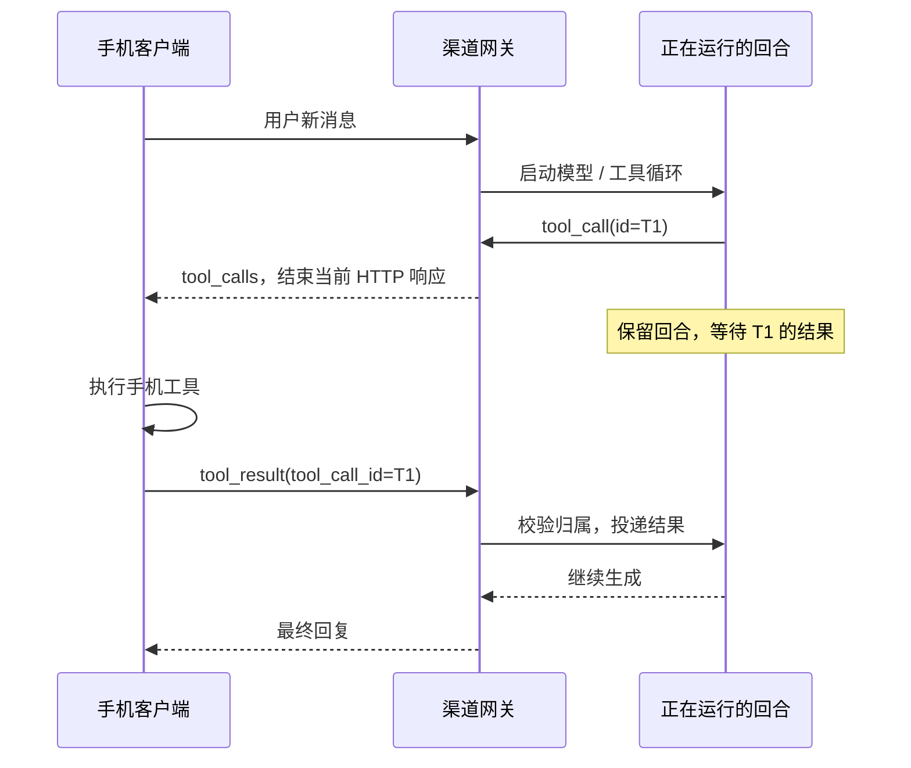

# 06 · 多端渠道怎样共享上下文

## 渠道只是入口

网页、手机原生聊天界面和消息桥接，都把新输入交给同一个后端。它们不各自维护一套“模型真正相信的历史”。

```text
网页说：周五 16:20 检查项目
       ↓ 同一账本
手机问：刚才约的几点？
       ↓ 读取同一会话上下文
模型看到约定并回答
```

后端写入后广播事件，在线网页更新；其他渠道拿到适合自己格式的回复。页面同步和模型上下文共享是两条工作：页面显示最新消息，不代表本次模型请求已经读到了它。

## 实际案例：Aru、iMessage 和微信

原应用接入了这三个渠道。以下只描述适配方式，不包含账号、绑定材料、实际服务地址或生产配置。

| 渠道 | 新消息如何进入主服务 | 渠道适配器负责的差异 |
|---|---|---|
| Aru | 接收 OpenAI 格式的聊天请求，转换后进入共享聊天处理流程 | 翻译流式事件、识别手机工具调用与结果、区分用户发言和客户端后台请求 |
| iMessage | 消息线路的 sidecar 把入站事件交给桥接程序；纯文字进入共享非流式聊天入口，图片进入图片入口 | 消息 ID 与引用原文对应、图片转换、把最终回复送回原消息渠道 |
| 微信 | 桥接程序把入站文字和图片交给共享流式聊天入口，读取最终回复事件 | 渠道消息去重、回信所需的渠道上下文、回复合并与发送 |

```text
Aru 请求 / 手机工具结果 ── 协议转换与回合定位 ──┐
iMessage 入站事件 ──────── 消息桥接 ──────────┤
微信入站事件 ──────────── 消息桥接 ──────────┤
网页输入 ────────────────────────────────────┘
                          ↓
                  主服务的共享聊天账本
                          ↓
                  同一套压缩、记忆与注入
                          ↓
                  对应入口支持的生成路径
                          ↓
                  回复落库，再由原渠道回传
```

### Aru：客户端协议与家里的上下文分开

Aru 会提交自己的消息格式和可用手机工具。网关取出这次真正的新输入，沿用主服务的历史与记忆来源，不把客户端整段 history 当成另一份总账。

手机工具在手机执行；结果下一次请求回来时，按调用 ID 找回等待中的回合。测连接、标题等后台请求单独处理，避免变成用户发言。下面的时序图就是这类流程。

当前接法可以根据明确的模型路由或引擎偏好进入 API / CC 分支。CC 使用手机能力时，还需要把调用桥回正在等待的手机回合；模型拥有 Bash 等服务器工具，不等于自动拥有手机权限。

### iMessage：借用消息线路，生成仍交给主服务

sidecar 负责消息线路，桥接程序负责接收与回复；生成和保存聊天由主服务完成。引用回复使用渠道消息 ID 反查对应原文，不能只把一个模型看不懂的 ID 塞进请求。

需要保留一个实际边界：当前这条桥走的是共享非流式 API / 图片入口，没有自动复用网页的 CC 选择。因此“能接上网页刚聊过的内容”成立，不代表“所有渠道都会跟着同一个模型开关走”。

### 微信：共享记录，发送方式单独适配

微信桥也把新输入交给主服务，不独立拼一份人设和历史。它当前通过渠道配置选择 API 或原 CC 路径，默认 API；这个配置与网页模型选择是不同的设置，不能混为一谈。

桥接程序保留回信需要的渠道上下文。当前实现把助手拆分的短句合并后发送，并识别流式入口最终的回复事件；这属于渠道输出适配，不应反过来改变总账中的对话含义。

### “上下文互通”不等于每个软件都显示完整记录

这里实现的核心是：从 Aru、iMessage、微信或网页进入的消息写入同一份记录，其他入口的下一轮生成可以通过这份记录接上前情。在线网页还可以收到后端广播。

没有把网页的全部历史自动复制到 iMessage 和微信各自的界面，也没有要求三个客户端都原样保存同一份模型 transcript。客户端能看到什么、主动消息发往哪里、离线后怎样补发，需要各自的渠道投递策略。

## 三个入口的虚构串聊例子

```text
1. 在 Aru 说：项目代号 LIME-73，周五 16:20 检查。
2. 换到 iMessage 问：刚才约的几点？
   → 主服务组装的前情应包含第 1 条约定。
3. 再到微信说：改到 17:10，原时间作废。
4. 回网页问：最终是几点？
   → 应回答 17:10，并能识别 16:20 已被更新。
```

这个例子是建议的验收用例，不是本仓库离线测试已连接三个真实渠道跑过的记录。除了检查答案，还要核对同一会话、来源消息 ID、实际注入资料和记录顺序。

## 统一入口要做什么

入口接收新事件，完成可信身份映射、会话定位、来源事件去重和完整回合排队，再走统一的上下文与回复流程。渠道标签继续保留，用来说明当前输出需要适配的界面能力。

客户端有时会提交它保存的整段 history。这些数据可以用来对齐事件或检测缺口，不能每次直接替换后端账本。否则旧手机里的旧历史会覆盖刚从网页写进来的内容。

同一个来源消息重复投递，只应产生一个用户事件和一次已完成回复。若生成中失败，重试要复用同一个事件 ID，而不是又塞一份用户消息。

离线示例用 `(channel, source_event_id)` 标识来源事件，并在同一会话内序列化整轮处理。数据库版本需要唯一约束、持久化状态和明确的事务边界；进程内锁无法处理跨进程并发。

## 手机工具如何跨 HTTP 接着跑

有的手机客户端会先接收工具调用、在手机上执行，再发起一个新 HTTP 请求回传结果。例如设置手机提醒、读取本机状态。后端必须知道这个结果属于哪一轮。



这里至少需要一个待处理映射：

```text
(用户身份, 会话, turn_id, tool_call_id)
    → 所属回合、等待位置、到期时间、交付状态
```

服务端不应只凭客户端提供的一个裸 `tool_call_id` 接收结果。要验证身份、会话归属，拒绝重复和过期交付，并限制结果体积。

原应用的手机网关使用后台回合线程加等待队列：HTTP 响应可以结束，工具循环的局部状态仍留在服务端，结果回来后继续。这个设计实现成本较低，但待处理状态在内存里；服务重启后无法天然续接。要求跨重启恢复时，需要持久化状态机，而不只是增加一层重试。

## 哪些请求不该算用户发言

手机客户端可能自动发送测连接、生成标题、生成摘要等请求。工具结果回传也不是一条新的用户聊天。

给它们单独分类，不把“Reply OK”、标题请求或工具返回值落成用户说的话。否则手机端和网页端看到的历史会越来越混乱，记忆提取也会把技术探测当作真实事件。

## 渠道能力可以不同，记忆来源保持一致

网页有文件预览，手机有本地提醒，消息桥接可能只支持文本或图片。统一保管上下文不意味着给每端相同的工具全集。

按当前渠道提供必要工具，并尽量保持工具定义顺序稳定。动态加载工具组会增加一次模型往返，还可能改变缓存前缀；是否划算要结合端点缓存能力实测。

## 断线和超时怎么说

客户端断开，不一定意味着模型回合应停止；应用需要明确是否继续执行、如何保存、怎样在重连时补发。

工具超时也不等于工具没执行。涉及有副作用的操作时，应记录“结果未知”，使用操作幂等键或查询实际状态，不能在恢复后盲目重做，也不能告诉用户“已经完成”。

离线演示覆盖渠道共享账本与去重，不实现手机权限、远程工具执行或完整 SSE 协议。实际接入时，用上述时序逐步联调。
