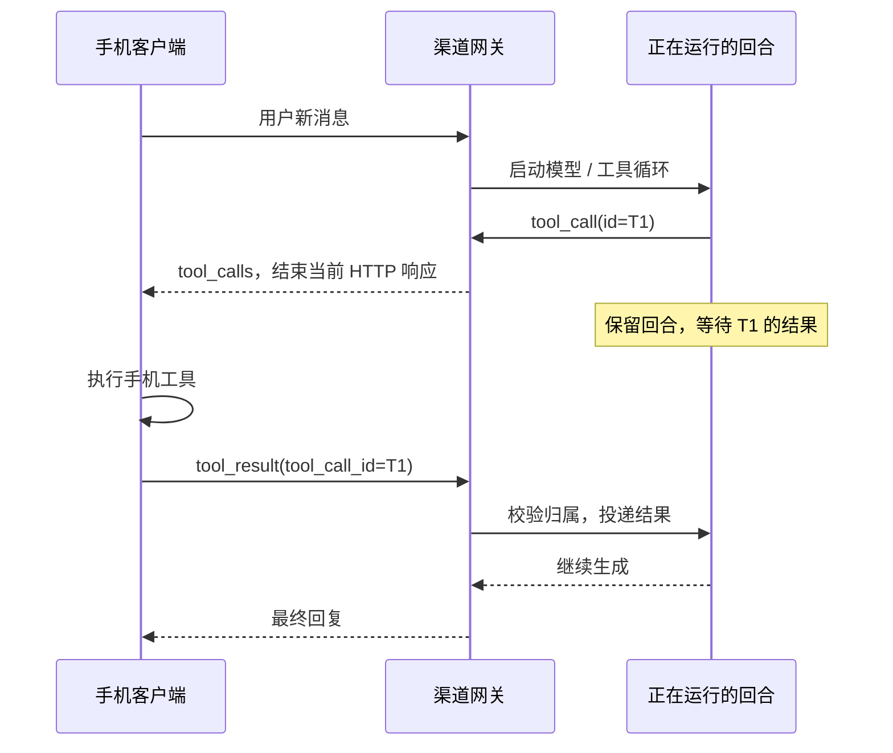

# 06 · 多端渠道怎样共享上下文

## 渠道只是入口

网页、手机原生聊天界面和消息桥接，都把新输入交给同一个后端。它们不各自维护一套“模型真正相信的历史”。

```text
网页说：周五 16:20 检查项目
       ↓ 同一账本
手机问：刚才约的几点？
       ↓ 读取同一会话上下文
模型看到约定并回答
```

后端写入后广播事件，在线网页更新；其他渠道拿到适合自己格式的回复。页面同步和模型上下文共享是两条工作：页面显示最新消息，不代表本次模型请求已经读到了它。

## 统一入口要做什么

入口接收新事件，完成可信身份映射、会话定位、来源事件去重和完整回合排队，再走统一的上下文与回复流程。渠道标签继续保留，用来说明当前输出需要适配的界面能力。

客户端有时会提交它保存的整段 history。这些数据可以用来对齐事件或检测缺口，不能每次直接替换后端账本。否则旧手机里的旧历史会覆盖刚从网页写进来的内容。

同一个来源消息重复投递，只应产生一个用户事件和一次已完成回复。若生成中失败，重试要复用同一个事件 ID，而不是又塞一份用户消息。

离线示例用 `(channel, source_event_id)` 标识来源事件，并在同一会话内序列化整轮处理。数据库版本需要唯一约束、持久化状态和明确的事务边界；进程内锁无法处理跨进程并发。

## 手机工具如何跨 HTTP 接着跑

有的手机客户端会先接收工具调用、在手机上执行，再发起一个新 HTTP 请求回传结果。例如设置手机提醒、读取本机状态。后端必须知道这个结果属于哪一轮。



这里至少需要一个待处理映射：

```text
(用户身份, 会话, turn_id, tool_call_id)
    → 所属回合、等待位置、到期时间、交付状态
```

服务端不应只凭客户端提供的一个裸 `tool_call_id` 接收结果。要验证身份、会话归属，拒绝重复和过期交付，并限制结果体积。

原应用的手机网关使用后台回合线程加等待队列：HTTP 响应可以结束，工具循环的局部状态仍留在服务端，结果回来后继续。这个设计实现成本较低，但待处理状态在内存里；服务重启后无法天然续接。要求跨重启恢复时，需要持久化状态机，而不只是增加一层重试。

## 哪些请求不该算用户发言

手机客户端可能自动发送测连接、生成标题、生成摘要等请求。工具结果回传也不是一条新的用户聊天。

给它们单独分类，不把“Reply OK”、标题请求或工具返回值落成用户说的话。否则手机端和网页端看到的历史会越来越混乱，记忆提取也会把技术探测当作真实事件。

## 渠道能力可以不同，记忆来源保持一致

网页有文件预览，手机有本地提醒，消息桥接可能只支持文本或图片。统一保管上下文不意味着给每端相同的工具全集。

按当前渠道提供必要工具，并尽量保持工具定义顺序稳定。动态加载工具组会增加一次模型往返，还可能改变缓存前缀；是否划算要结合端点缓存能力实测。

## 断线和超时怎么说

客户端断开，不一定意味着模型回合应停止；应用需要明确是否继续执行、如何保存、怎样在重连时补发。

工具超时也不等于工具没执行。涉及有副作用的操作时，应记录“结果未知”，使用操作幂等键或查询实际状态，不能在恢复后盲目重做，也不能告诉用户“已经完成”。

离线演示覆盖渠道共享账本与去重，不实现手机权限、远程工具执行或完整 SSE 协议。实际接入时，用上述时序逐步联调。
